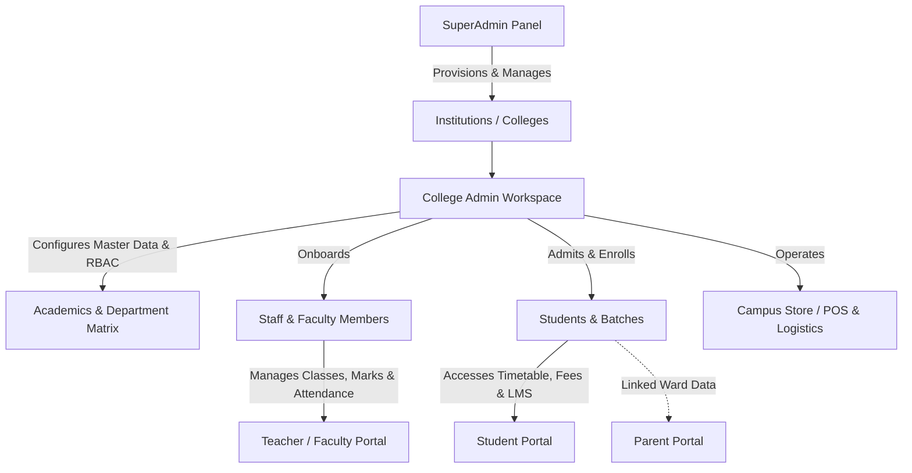
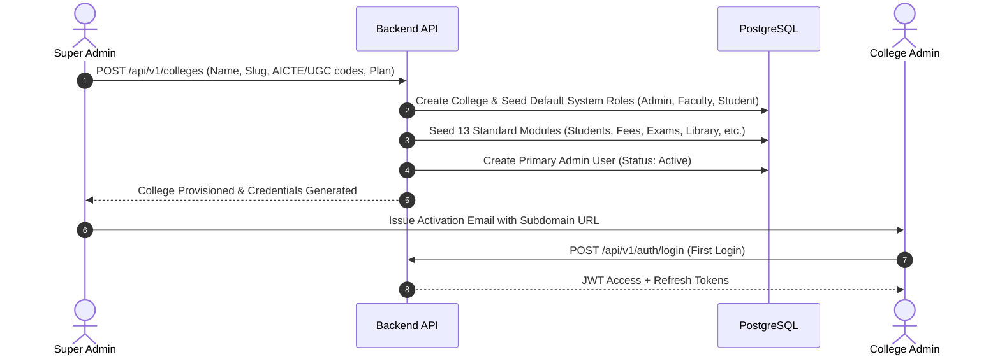
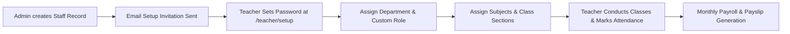
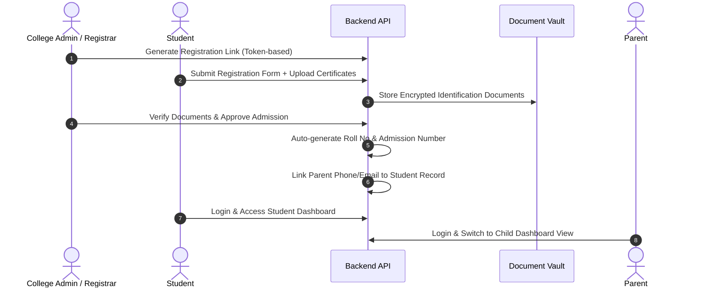
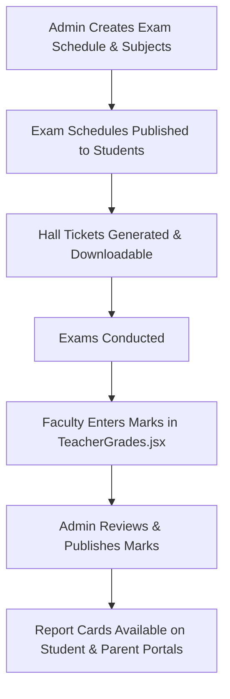
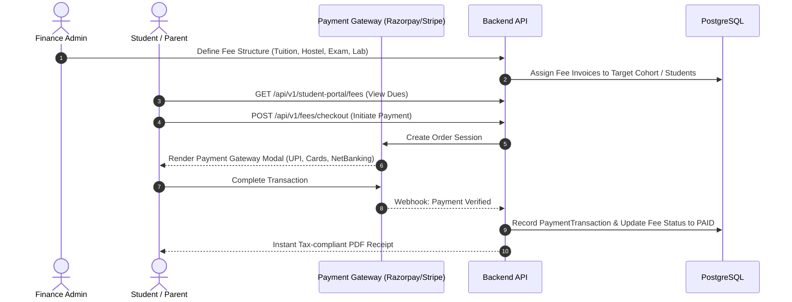
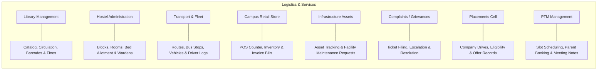

# College Management System (CMS) — Complete Workflow & Architecture Guide

> **Document Type:** System Workflow & Operational Architecture Guide  
> **Target Application:** Zuna College Management System (Multi-Tenant Institutional ERP)  
> **Workspace Root:** `c:\College-Management-System-official`  

---

## 1. Executive System Overview

The **College Management System (CMS)** is a multi-tenant institutional Enterprise Resource Planning (ERP) platform designed to automate and unify academic, administrative, and financial operations for colleges, polytechnics, and universities.

### Core Architectural Principles
1. **Multi-Tenancy & Data Isolation**:
   - Every tenant institution has an isolated namespace scoped by `collegeId` (UUID).
   - Multi-tenant routing is resolved dynamically via subdomain, college slug, or JWT token context (`resolveTenant.js`).
2. **Dynamic Role-Based Access Control (RBAC)**:
   - High-level system roles: `superadmin`, `admin`, `teacher` (faculty/HOD), `student`, `parent`.
   - Dynamic custom roles: Granular CRUD permission matrix (`canCreate`, `canRead`, `canUpdate`, `canDelete`) evaluated per module on every API call (`requirePermission.js`).
3. **Omnichannel Access**:
   - **Web Application** (React, Tailwind CSS, Vite): Responsive responsive web application with dedicated panels.
   - **Mobile Application** (React Native, Expo): Cross-platform native interface for students, faculty, and administrators.
4. **Resilient Data Exchange**:
   - Single-flight JWT token refresh queue.
   - BroadcastChannel cross-tab real-time session synchronization.
   - Bulk Excel (`.xlsx`/`.csv`) data ingestion engine with relational key resolution.



---

## 2. Platform Portals & Access Matrix

The system organizes functionality across 5 primary portals and specialized auxiliary interfaces:

| Portal | Route Prefix | Primary Users | Key Responsibilities |
| :--- | :--- | :--- | :--- |
| **Super Admin Portal** | `/super/*` | Platform Owners & DevOps | College tenant onboarding, subscription plans, global module catalog, system-wide analytics, support tickets. |
| **College Admin Portal** | `/admin/*` | Principals, Registrars, Operations | Institution-level ERP: Student/Staff directories, academic hierarchies, fee structures, examinations, logistics, and RBAC matrix. |
| **Teacher / Faculty Portal** | `/teacher/*` | Professors, Lecturers, HODs | Daily classroom operations: lecture attendance, assignment grading, exam mark entry, leave applications, PTM conferences. |
| **Student Portal** | `/student/*` | Enrolled Students | Class schedules, attendance tracking, online fee payments, assignments, document locker, hostel/transport status. |
| **Parent Portal** | `/parent/*` | Parents & Guardians | Multi-child ward switcher, real-time attendance alerts, fee dues checkout, report cards, teacher communication. |
| **Campus Store & POS** | `/admin/store/*` | Store Managers, Cashiers | Barcode retail counter, item inventory, inventory movement tracking, invoice PDF generation. |

---

## 3. End-to-End Operational Workflows

### Workflow 1: Tenant Provisioning & College Onboarding



1. **Registration**: Superadmin enters institution details, licensing tier (Trial/Pro/Enterprise), and statutory credentials (AICTE, UGC, PAN/TAN).
2. **Automated Seeding**:
   - The database automatically creates the `College` entity.
   - Generates default system roles with preconfigured permissions.
   - Seeds standard modules (`students`, `staff`, `attendance`, `fees`, `exams`, `library`, `hostel`, `transport`, `store`, `payroll`, `infrastructure`, etc.).
3. **College Branding**: The administrator customizes logo, academic year, grading patterns, and institutional email configurations.

---

### Workflow 2: Academic & Institutional Structure Setup

Before admitting students or hiring staff, the College Admin configures the academic hierarchy:

1. **Departments**: Admin creates departments (e.g., *Computer Science, Mechanical Engineering, Business Administration*).
2. **Courses / Programs**: Admin adds degrees (e.g., *B.Tech, MBA, B.Sc*) associated with departments, defining duration and semester count.
3. **Sections & Batches**: Defines specific cohorts (e.g., *Batch 2024–2028, Section A, Semester 3*).
4. **Subject Mapping**: Curriculum subjects are registered and mapped to respective courses and semesters.

---

### Workflow 3: Staff & Faculty Lifecycle Management



1. **Onboarding**:
   - **Individual**: Admin registers staff profile (Personal details, designation, qualification, PAN/Aadhaar).
   - **Bulk Ingestion**: Admin uploads `.xlsx` staff sheet with automated column matching and validation.
2. **Credential Setup**: Staff member receives a secure cryptographic setup token link (`/teacher/setup?token=...`) to set their password.
3. **Role & Permission Allocation**:
   - Standard roles (e.g., `Teacher`, `HOD`, `Accountant`, `Librarian`).
   - Custom dynamic roles created in `RolesManagement.jsx` with custom CRUD flags.
4. **Academic Workload Assignment**: Staff are allocated specific subjects and timetable lecture slots.
5. **HR & Payroll Operations**:
   - Staff apply for leaves (`/admin/my-leaves` or `/teacher/my-leaves`).
   - HOD/Admin approves or rejects leave requests.
   - Payroll runs compute base salary, deductions, and bonuses, generating printable payslips (`PayrollDashboard.jsx`).

---

### Workflow 4: Student Admission, Enrollment & Linking



1. **Admissions Channel**:
   - **Direct Intake**: Admin enters candidate details in `AdmissionFormModal.jsx`.
   - **Public Self-Registration**: Admin generates a token-protected student registration link (`/student/register?token=...`). Candidate submits personal information and documents.
   - **Bulk Import**: Registrar imports hundreds of student records via Excel batch upload (`BulkImportModal.jsx`).
2. **Document Verification**: Transcripts, transfer certificates, and ID proofs uploaded to `DocumentVault` are reviewed and approved.
3. **Enrollment & Section Assignment**:
   - Student is allocated an Admission Number, Roll Number, Section, and Academic Year.
4. **Parent Linkage**:
   - Parents are linked to students via unique Parent Mobile/Email credentials.
   - The Parent Portal supports a **Multi-Child Switcher**, allowing a single parent to toggle between siblings studying in the same institution.

---

### Workflow 5: Daily Academic Operations (Attendance, Timetable, Exams)

#### A. Timetable & Daily Schedule
- Admin/HOD builds the master weekly schedule assigning room numbers, lecture slots, faculty members, and sections.
- Both Teachers and Students receive synchronized live daily agendas on their dashboards.

#### B. Attendance Pipeline
- **Teacher View**: Teacher opens `TeacherAttendance.jsx`, selects Course/Section/Subject, and marks Present/Absent/Late with one click.
- **Data Propagation**: Attendance percentages update instantly.
- **Student & Parent Visibility**: Students see attendance percentage meters. If attendance dips below statutory thresholds (e.g., 75%), alerts trigger. Parents view calendar heatmaps of absent dates.

#### C. Assignments & Continuous Evaluation
- **Creation**: Teacher posts an assignment with title, description, attachments, and deadline.
- **Submission**: Student uploads solution documents through `StudentAssignmentsDashboard.jsx`.
- **Grading**: Teacher evaluates submissions, assigns grades/marks, and leaves written feedback.

#### D. Examination Lifecycle


---

### Workflow 6: Finance, Fee Structures & Online Collections



1. **Structure Definition**: Admin sets tuition fees, semester fees, hostel fees, and transport fees with due dates and late fine rules.
2. **Invoicing**: Fees are attached to batches, individual students, or category quotas (General, Scholarship, Merit).
3. **Collection Modes**:
   - **Online**: Students or parents pay directly inside the portal with instant digital receipt generation.
   - **Counter / Offline**: Cashier collects Cash, Cheque, or DD and records manual transaction receipts.
4. **Reconciliation**: Finance managers track collection statistics, outstanding balances, and defaulter lists in `FinancialSummaryChart.jsx`.

---

### Workflow 7: Campus Logistics & Auxiliary Modules



- **Library**: Book cataloging, ISBN lookup, check-out/check-in tracking, automatic late fine computation.
- **Hostel**: Block allocation, room capacity monitoring, student check-in/out, warden leave approval passes.
- **Transport**: Vehicle inspection records, route tracking, designated bus stops, and student passenger manifests.
- **Campus Store & POS**: Retail point-of-sale terminal for uniforms, books, stationery, with instant receipt printing.
- **Infrastructure**: Facility repair requests submitted by staff and tracked to resolution by maintenance teams.
- **Complaints Desk**: Anonymous or identified grievance ticketing with SLA status updates.
- **Placements Desk**: Campus recruitment drives, eligibility filtering, and selection outcome analytics.
- **PTM (Parent-Teacher Meetings)**: Teachers publish available time slots; parents book meetings online.

---

### Workflow 8: Auditing, Governance & Reporting

1. **Full Audit Logging (`AuditLogs.jsx`)**:
   - Every sensitive administrative action (create, update, delete, role alteration) is intercepted by `auditMiddleware.js`.
   - Records actor ID, college tenant, IP address, user-agent, route, and a human-readable diff of modified fields.
2. **Export Engine (`reportExporter.js`)**:
   - Generates formatted reports in Excel (`.xlsx`), PDF, and CSV across Attendance, Financial Ledgers, Student Demographics, and Grade Performance.

---

## 4. Security & Access Control Flow

```mermaid
flowchart TD
    Req[Incoming HTTP Request] --> AuthCheck{JWT Valid?}
    AuthCheck -- No --> 401[401 Unauthorized]
    AuthCheck -- Yes --> TenantCheck{Valid Tenant Context?}
    TenantCheck -- No --> 403T[403 Invalid College Domain]
    TenantCheck -- Yes --> RoleCheck{System Role Admin/Superadmin?}
    RoleCheck -- Yes --> Allow[Execute Controller Action]
    RoleCheck -- No --> CustomRoleCheck{Custom Role Assigned?}
    CustomRoleCheck -- No --> 403R[403 Forbidden]
    CustomRoleCheck -- Yes --> PermCheck{RolePermission has can[Action] for Module?}
    PermCheck -- Yes --> Allow
    PermCheck -- No --> 403P[403 Module Action Forbidden]
```

### Authorization Architecture
1. **JWT Header**: Client sends `Authorization: Bearer <accessToken>`.
2. **Tenant Verification**: Middleware verifies the token's `collegeId` matches the institution domain being accessed.
3. **Role Evaluation**:
   - `superadmin`: Global bypass to all endpoints.
   - `admin`: Full administrative access within their assigned `collegeId`.
   - Custom staff/faculty roles: Dynamically queried from `RolePermission` cache matching `[moduleKey][action]`.

---

## 5. Technology Stack Reference

| Layer | Technologies Used | Key Responsibilities |
| :--- | :--- | :--- |
| **Frontend Web** | React 18, Vite, Tailwind CSS, TanStack Query, Framer Motion, Lucide Icons | Multi-portal responsive Single Page Application (SPA). |
| **Backend Server** | Node.js, Express.js (ES Modules), Prisma ORM | Multi-tenant RESTful APIs, validation via Zod, audit trails. |
| **Database** | PostgreSQL (Supabase / Neon / Self-hosted) | Relational multi-tenant schema with foreign key constraints and UUID PKs. |
| **Mobile App** | React Native, Expo, Redux Toolkit, Keychain | Native iOS and Android mobile interfaces. |
| **Document Vault & Media** | Cloudinary / Local Storage Engine | Student photographs, statutory certificates, and assignment attachments. |
| **Reporting & Export** | SheetJS (`xlsx`), jsPDF, jsPDF-AutoTable | Client-side and server-side report compilation. |

---

## 6. Directory Structure Overview

```
College-Management-System-official/
├── Backend/
│   ├── prisma/
│   │   ├── schema.prisma            # Master database schema (45+ models)
│   │   └── seed-modules.mjs         # Module catalog seeder
│   └── src/
│       ├── middleware/              # authenticate.js, requirePermission.js, auditMiddleware.js
│       ├── modules/                 # 40+ modular domains (students, staff, fees, exams, etc.)
│       └── server.js                # Express server bootstrapper
├── Frontend/
│   ├── src/
│   │   ├── contexts/                # AuthContext.jsx, ConfirmContext.jsx
│   │   ├── hooks/                   # React Query custom hooks per domain
│   │   ├── pages/
│   │   │   ├── superadmin/          # SuperAdminLayout.jsx & platform admin screens
│   │   │   ├── admin/               # AdminLayout.jsx & 25+ institutional modules
│   │   │   ├── teacher/             # TeacherLayout.jsx & faculty workflows
│   │   │   ├── student/             # StudentLayout.jsx & 15 student portals
│   │   │   ├── parent/              # ParentLayout.jsx & multi-child screens
│   │   │   └── shared/              # Store POS & PTM dialogs
│   │   └── services/apiClient.js    # Axios client with single-flight token refresh
└── Mobile/                          # React Native mobile client codebase
```
